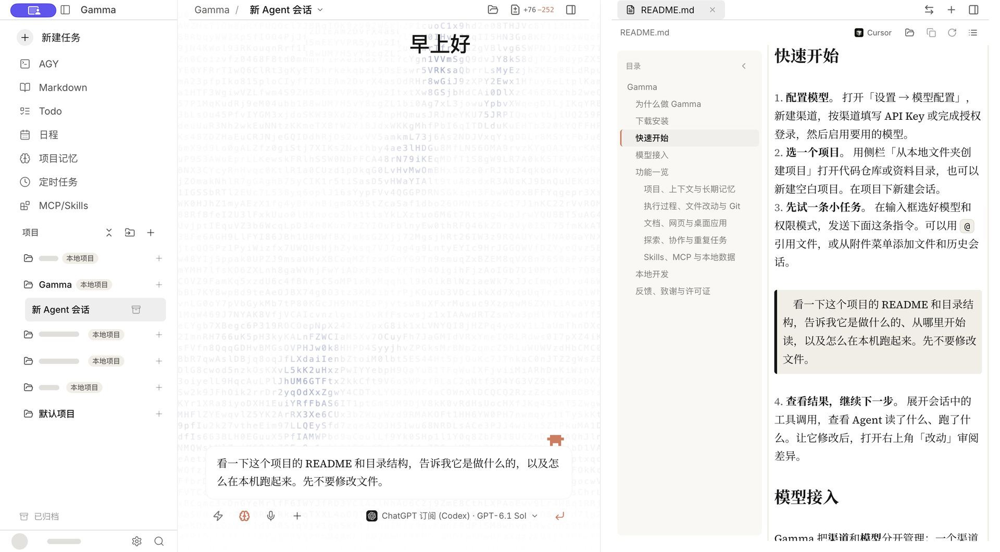

# Gamma

**基于 [Pi Agent SDK](https://github.com/earendil-works/pi) 的开源桌面 Agent。用你自己的模型，在本地项目里做事。**

[下载安装](#下载安装) · [快速开始](#快速开始) · [模型接入](#模型接入) · [功能一览](#功能一览) · [本地开发](#本地开发)

[](https://github.com/xhslam/Gamma/releases/latest)
[](./LICENSE)

## 为什么做 Gamma

我想把 Pi Agent 带到桌面。选 Pi，是因为它把**模型接入**和 **Agent 执行**分开了：我可以按任务换模型，同一个 Agent 仍然可以读文件、调用工具、运行命令并根据结果继续工作。我希望保留 Pi 的这种灵活性，同时能在一个窗口里管理多个项目、看清 Agent 改了什么，关掉应用以后也能接着做。

Gamma 把 [Pi Coding Agent SDK](https://github.com/earendil-works/pi/tree/main/packages/coding-agent) 嵌入 Electron 应用，直接用 SDK 创建和运行会话。Pi 的 `pi-ai` 接入模型，`pi-agent-core` 负责 Agent 循环和工具执行；Gamma 在其上提供项目与会话管理、模型配置、工具权限、文件改动视图、终端和自动化。安装 Gamma 后，无需另装 Pi CLI。



*截图来自 macOS 上实际运行的 Gamma v0.19.242，个人资料和其他项目名称已遮盖。*

| 你想做的事 | 在 Gamma 里怎么做 |
| --- | --- |
| 修复项目里的 bug | 打开代码仓库，先让 Agent 排查并给出计划，再让它修改和跑测试；在「改动」里逐个查看差异。 |
| 整理资料、写报告 | 打开资料目录，引用本地文件或上次调研会话，让 Agent 整理到 Markdown；在同一个窗口里预览和编辑。 |
| 换个模型继续做 | 在会话中切换模型；项目、历史和文件仍由 Gamma 管理。 |
| 把重复工作交给 Agent | 保存一条任务指令，绑定项目和模型，再设定时间或运行间隔；回到应用查看执行记录。 |

## 下载安装

从 [GitHub Releases](https://github.com/xhslam/Gamma/releases/latest) 下载与你的系统和处理器匹配的安装包。

| 平台 | 选哪个文件 |
| --- | --- |
| macOS · Apple 芯片 | `mac-arm64.dmg` 或 `mac-arm64.zip` |
| macOS · Intel 芯片 | `mac-x64.dmg` 或 `mac-x64.zip` |
| Windows · x64 | `win-x64.exe` |
| Linux · x86_64 | Debian / Ubuntu 用 `.deb`，也可选 `.AppImage`；参见 [Linux 安装说明](./docs/linux.md)。 |

当前 GitHub Release 的 macOS 安装包使用临时签名，未经过 Apple 公证；自动更新安装尚未验证。请以各版本发布说明为准。

**从 Proma 迁移：**首次启动 Gamma 前先退出旧版 Proma。符合迁移条件时，Gamma 会复制受管数据到 `~/.gamma/`，保留原 `~/.proma/`。如果两个目录都已有数据，请先备份，不要手动覆盖。

## 快速开始

1. **配置模型。** 打开「设置 → 模型配置」，新建渠道，按渠道填写 API Key 或完成授权登录，然后启用要用的模型。
2. **选一个项目。** 用侧栏「从本地文件夹创建项目」打开代码仓库或资料目录，也可以新建空白项目。在项目下新建会话。
3. **先试一条小任务。** 在输入框选好模型和权限模式，发送下面这条指令。可以用 `@` 引用文件，或从附件菜单添加文件和历史会话。

   > 看一下这个项目的 README 和目录结构，告诉我它是做什么的、从哪里开始读，以及怎么在本机跑起来。先不要修改文件。

4. **查看结果，继续下一步。** 展开会话中的工具调用，查看 Agent 读了什么、跑了什么。让它修改后，打开右上角「改动」审阅差异。

## 模型接入

Gamma 把**渠道**和**模型**分开管理：一个渠道保存供应商、端点及凭据，可以启用多个模型。配置好后，在会话输入框选择要用的模型；有支持的模型时，还可以调整推理档位。

| 接入方式 | 支持的选项 |
| --- | --- |
| 供应商 API | Anthropic Claude、OpenAI、Google Gemini、DeepSeek、Kimi、智谱 GLM、豆包、MiniMax、通义千问、小米 MiMo |
| 编程或用量套餐 | Kimi Coding、智谱 Coding（含团队版）、通义千问 Token Plan、小米 MiMo Token Plan |
| 账号授权 | ChatGPT 订阅（Codex）、GitHub Copilot、xAI；可用模型取决于账号权限 |
| 自定义端点 | OpenAI 兼容接口、OpenAI Responses、Anthropic 兼容接口；也可以接提供相应协议的自建服务 |

模型是否支持工具调用、图片输入和推理档位，由模型及渠道决定。要让 Agent 改文件或执行命令，请选择支持工具调用的模型。配置云端渠道时，完成任务所需的对话、附件内容和工具结果可能发送给该服务。

## 功能一览

### 项目、上下文与长期记忆

- **项目与会话。** 把本地文件夹或 Git 仓库作为工作目录，按项目保存和恢复会话，也可搜索、加星和归档。项目文件仍留在原目录。
- **引用文件与历史。** 用 `@` 选项目文件，或通过附件菜单引用以前的会话，接着做上次的任务，详见[会话引用说明](./docs/conversation-reference.md)。
- **规则与记忆。** 在 Gamma 配置目录的 `AGENTS.md` 写个人通用规则，在项目的 `AGENTS.md` 写项目约定。项目记忆用于保留跨会话的背景和结论；全局长期记忆可在设置中管理。

### 执行过程、文件改动与 Git

- **跟进 Agent 的行动。** 会话中可查看工具调用、执行结果和任务进度；可以让 Agent 先给计划再决定是否执行，也可以中止当前运行。
- **审阅文件变更。** 在文件面板浏览项目或本次会话涉及的文件，在「改动」里查看文件差异。Git 项目还可以通过 worktree 给任务使用单独的工作目录。
- **直接使用终端。** 打开项目终端运行命令和查看输出，必要时自己接手验证。侧栏的 AGY 提供独立的终端入口，使用前需要本机有可用的 `agy`。

### 文档、网页与桌面应用

- **Markdown 与文件预览。** 在 Markdown 工作区打开和编辑本地笔记，可使用公式、Mermaid 图和任务列表。工作区也可打开已有的 Obsidian 笔记目录。支持预览 PDF 及常见 Office 文档，并通过随附的文档 Skills 处理 Word、Excel 和 PowerPoint 文件。
- **内置浏览器。** 在工作台里打开网页，也可让 Agent 使用浏览器工具导航、读取页面和执行网页交互。网页访问和登录取决于对应站点。
- **电脑操作（macOS）。** 授予「辅助功能」权限后，Agent 可以读取受支持应用的界面结构并执行点击、输入或滚动。可选画面预览需要单独授权；应用访问和敏感操作受电脑操作权限策略约束，你可以停止正在进行的操作。

### 探索、协作与重复任务

- **探索分支与子会话。** 从主会话开一个探索分支试不同方案，再把有用的结果带回；也可以把独立任务交给子会话处理，并在主会话查看进展和结果。
- **定时任务。** 将提示词、项目和模型保存成任务，设置单次、每天、每周、每月或按间隔执行；间隔任务可以限定工作日和运行时段。也可以手动触发并查看运行记录，定时调度需要桌面应用保持运行。
- **Todo 与日程。** 在应用内整理待办和日程；macOS 14 及以上可授权同步系统日历和提醒事项。

### Skills、MCP 与本地数据

- **Skills 定义做事方法。** 使用内置的文档处理、计划、浏览器等 Skills，或为项目添加自己的 `SKILL.md`，把常用流程留给下次任务。
- **MCP 提供额外工具。** 在「MCP/Skills」里管理本地或远程 MCP 服务，让 Agent 使用其提供的搜索、数据查询或其他能力。能用哪些工具取决于服务和授权。
- **本地优先。** 会话、配置和记忆由桌面应用保存，主要位于 `~/.gamma/`，便于备份。在系统支持时，Gamma 通过 Electron `safeStorage` 加密 API Key；模型请求和联网工具仍按所选渠道和服务访问网络。

## 本地开发

仓库使用 **Bun**。发布构建使用 Bun 1.3.14 和 Node.js 22；构建原生电脑操作组件时，还需要 Rust 1.89.0。

```bash
git clone https://github.com/xhslam/Gamma.git
cd Gamma
bun install --frozen-lockfile
bun run dev
```

| 任务 | 命令 |
| --- | --- |
| 类型检查 | `bun run typecheck` |
| 测试 | `bun test` |
| 构建 Electron 应用 | `bun run electron:build` |
| 构建安装包 | `bun run dist:mac`、`bun run dist:win` 或 `bun run dist:linux` |

桌面应用在 [`apps/electron`](./apps/electron)，默认 Skills 在 [`apps/electron/default-skills`](./apps/electron/default-skills)，共享包在 [`packages`](./packages)。提交改动前请阅读 [AGENTS.md](./AGENTS.md)。

## 反馈、致谢与许可证

欢迎通过 [GitHub Issues](https://github.com/xhslam/Gamma/issues) 报告问题。附上 Gamma 版本、操作系统和复现步骤，并请勿附上 API Key 或私人会话内容。

感谢 [Pi](https://github.com/earendil-works/pi) 提供 Agent SDK，以及 [Proma](https://github.com/proma-ai/Proma) 提供早期的桌面应用基础。

Gamma 社区版按 [AGPL-3.0](./LICENSE) 开源。需要另行商业授权可联系 [gan798798@qq.com](mailto:gan798798@qq.com)。向本项目提交 Pull Request 即视为同意将所贡献代码以 AGPL-3.0 及未来商业许可授权给项目维护者。
